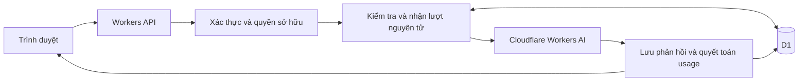

# Kế hoạch website chatbot dùng Cloudflare

Ngày lập: 05/10/2026. Thư mục dự án: `D:\LTWWEB\phanmemchatbot`.

Backend đã được triển khai bằng Workers/Hono/D1 trong `backend/`, có OAuth, API hội thoại, quota, cấu hình quản trị, reconciliation và cron. Frontend React/TypeScript/Vite trong `frontend/` có đăng nhập, chat, lịch sử, hạn mức token, quản trị cấu hình/tài khoản/request/audit và bố cục responsive. Workers Static Assets đã nối với bản build frontend để phục vụ API cùng domain. Hướng dẫn chạy nằm trong README của mỗi thư mục. Chưa publish production; Workers AI/Google OAuth thật còn cần credentials để kiểm chứng.

## 1. Mục tiêu và giả định

Xây dựng website chatbot hoàn chỉnh bằng tiếng Việt, sử dụng Cloudflare Workers AI, lưu lịch sử hội thoại và giới hạn token theo từng phiên chat. Lượt vượt ngân sách không được trả lời; người dùng phải tạo phiên mới để tiếp tục. Chủ website chỉnh được hạn mức trên giao diện.

Yêu cầu đã được người dùng xác nhận:

- Dịch vụ AI: Cloudflare Workers AI, dùng model do Cloudflare cung cấp.
- Hạn mức có thể chỉnh trên giao diện; 2.000 token/phiên là giá trị ví dụ và mặc định đề xuất.
- Nếu lượt chat vượt ngân sách, không trả lời và yêu cầu tạo phiên mới. Không cho hoàn tất một lượt vượt ngưỡng rồi mới khóa.

Đề xuất thiết kế để triển khai các yêu cầu trên:

- Token sử dụng = tổng token đầu vào và đầu ra của tất cả lần gọi AI trong phiên, theo usage do nhà cung cấp trả về. Đây là cách tính đề xuất, chưa phải lựa chọn được người dùng xác nhận riêng.
- Quản trị viên chỉnh hạn mức mặc định cho phiên mới trên giao diện. Có thêm thao tác chỉnh hạn mức một phiên đang hoạt động nếu cần; phiên đã khóa không được mở lại bằng cách tăng hạn mức.
- Website dành cho nhiều người dùng, có đăng nhập, lịch sử riêng và vai trò quản trị viên.
- Bản đầu hỗ trợ chat văn bản; tải tài liệu, RAG, hình ảnh, giọng nói và thanh toán thuộc giai đoạn mở rộng.

Lựa chọn đăng nhập và cách tính tổng token là giả định triển khai có thể điều chỉnh trước khi viết mã. Hai điểm đã chốt là Workers AI và không trả lời lượt vượt ngân sách.

## 2. Phạm vi chức năng

### Người dùng

- Đăng nhập/đăng xuất; mặc định dùng Google OAuth để không phải xây luồng mật khẩu và gửi email trong bản đầu.
- Tạo nhiều phiên chat; mỗi phiên có hạn mức và bộ đếm riêng.
- Gửi câu hỏi, nhận phản hồi AI trong hạn mức, hiển thị Markdown và đoạn mã có nút sao chép.
- Xem danh sách phiên theo thời gian, tìm theo tiêu đề, đổi tên, lưu trữ và xóa phiên.
- Mở lại lịch sử sau khi tải lại trang hoặc đăng nhập trên thiết bị khác.
- Xem token đã dùng, hạn mức, trạng thái phiên và mức sử dụng theo phần trăm.
- Nhận cảnh báo gần hạn mức; lượt không đủ ngân sách bị từ chối để sửa câu hỏi. Phiên đã chạm hạn mức chỉ xem lại lịch sử và cần tạo mới.
- Nút “Tạo phiên mới” mở hội thoại trống và bộ đếm bằng 0, không tự chuyển lịch sử cũ sang.
- Giao diện responsive, sáng/tối, dùng được bằng bàn phím và có thông báo lỗi rõ ràng.

### Quản trị viên

- Xem số người dùng, phiên chat, lượt gọi, token đầu vào/đầu ra và lỗi API.
- Cấu hình hạn mức mặc định, model cho phiên mới, system prompt, giới hạn đầu vào và đầu ra mỗi lượt.
- Bật/tắt model được phép, khóa tài khoản và cấu hình giới hạn tần suất gửi/tạo phiên.
- Xem nhật ký lỗi và thay đổi cấu hình; nội dung hội thoại riêng không hiển thị mặc định trong dashboard.
- Form “Hạn mức token/phiên” có input số, ví dụ 2.000/5.000/10.000, nút lưu, validation và thông báo phạm vi áp dụng. Chỉ admin được chỉnh; user thường chỉ xem.
- Đổi hạn mức mặc định hoặc model áp dụng cho phiên mới. Phiên cũ giữ cấu hình đã chụp khi tạo để hành vi nhất quán.
- Thao tác riêng “Chỉnh hạn mức phiên này” chỉ dành cho admin với phiên còn active, không có request đang xử lý. Nếu hạ xuống bằng hoặc dưới số đã dùng thì khóa ngay; tăng hạn mức không được mở lại phiên đã khóa. Mọi thay đổi có audit.
- API token Cloudflare được cấu hình qua secret phía máy chủ, không nhập hoặc xem lại trong giao diện quản trị.

## 3. Quy tắc token và vòng đời phiên

### Cách tính

```text
token_luot = usage.prompt_tokens + usage.completion_tokens
token_phien = tổng token_luot đã quyết toán của phiên
```

Nếu API dùng tên trường khác, lớp kết nối chuẩn hóa về `input_tokens`, `output_tokens`, `total_tokens`. Không cộng reasoning/cached tokens thêm lần nữa nếu đã nằm trong các số tổng của nhà cung cấp. Giá trị bất thường hoặc thiếu usage không được mặc định thành 0.

Token đầu vào bao gồm system prompt, lịch sử thực sự gửi lại và câu hỏi mới. Vì vậy, phần lịch sử có thể được tính lại ở nhiều lượt. Token khác với số từ hoặc ký tự; không dùng công thức ký tự/4 để quyết định quota. Kiểm tra trước khi gọi cần tokenizer đúng model và đầy đủ chat template/special tokens; số quyết toán sau lượt lấy từ usage thật.

Đây là hạn mức lượng token API đã sử dụng trong phiên. Nếu mục tiêu thực tế là giới hạn chiều dài nội dung hội thoại, cần một chính sách khác: đếm nội dung hiện có một lần thay vì cộng usage của từng lượt.

### Chính sách đã chốt: không trả lời lượt vượt ngân sách

```text
con_lai = token_limit - used_tokens
input_luot = token của toàn bộ prompt đã dựng, bao gồm template
ngan_sach_output = con_lai - input_luot - phan_du_phong_da_kiem_chung

Nếu ngan_sach_output < 1:
  Không gọi AI, không trả lời, không cộng token; giữ phiên active để sửa câu hỏi.
  Có thể tạo phiên mới nếu lịch sử khiến lượt tiếp theo không còn đủ chỗ.
Nếu đủ:
  max_tokens = min(max_output_tokens_cau_hinh, ngan_sach_output)
  Dành trước ngân sách lượt, rồi gọi AI.
```

Phần dự phòng chỉ sử dụng khi có cơ sở kiểm chứng hoặc chặn trên rõ ràng. Không coi cộng thêm một số tùy ý là bảo đảm khớp số token của nhà cung cấp. Bản đầu ưu tiên một model văn bản không có reasoning ẩn, tokenizer có thể sử dụng phía máy chủ và API hỗ trợ `max_tokens`.

Ví dụ dưới đây giả sử input đã tính đúng và không cần phần dự phòng:

| Đã dùng | Input của lượt mới | Ngân sách output | Kết quả |
| --- | --- | --- | --- |
| 1.200 | 150 | Tối đa 650 | Gọi AI, cap output theo cấu hình và phần còn lại |
| 1.800 | 250 | Không đủ | Không gọi AI, không trả lời; phiên vẫn active, có thể rút gọn câu hỏi |
| 1.800 | 100 | Tối đa 100 | Cho trả lời trong 100 token; báo nếu bị cắt do hết ngân sách |
| 1.999 | 2 | Không đủ | Không gọi AI; tổng vẫn 1.999, từ chối riêng lượt này |
| 2.000 | Bất kỳ | Không đủ | Không gọi AI, yêu cầu phiên mới |

Máy chủ chỉ nhận lượt nếu phiên thuộc người dùng hiện tại, chưa khóa/lưu trữ/xóa, không có lượt đang xử lý hoặc usage chưa rõ, và còn ngân sách. Chặn request trước gọi AI khi xác định không đủ, không chờ AI sinh xong mới quyết định trong luồng bình thường.

Sau khi có usage thật, quyết toán và kiểm tra lại trước khi trả nội dung. Nếu tổng usage thực tế vượt hạn mức hoặc provider vượt giới hạn output đã gửi, không gửi câu trả lời cho người dùng; vẫn ghi nhận usage thực tế, khóa phiên và báo lỗi. Input thực tế cao hơn ước tính nhưng tổng vẫn nằm trong hạn mức không tự khóa phiên. Không sửa số thực xuống 2.000 để che chi phí.

Đã đối chiếu offline với 7 lượt Cloudflare Llama 3.3 thật lưu trong D1: usage input cao hơn tokenizer thô 1 token trong cả 7 lượt. Local dùng tokenizer và 2 token dự phòng. Cần đối chiếu thêm khi đổi model/template; không coi dữ liệu hiện tại là bảo đảm trần chi phí Cloudflare tuyệt đối. Yêu cầu sản phẩm “không trả lời nếu vượt” được bảo vệ bằng phản hồi không streaming và kiểm tra usage cuối.

Người dùng không được sửa trạng thái hoặc đặt lại bộ đếm. Khi đã chạm ngân sách thực tế, phiên chuyển `limit_reached`. Kiểm tra đầu vào từ chối riêng lượt không đủ ngân sách, giữ phiên active và trả `requires_new_conversation=false`. Thanh tiến trình tối đa 100%, hiển thị số thực và lý do khóa. Migration sửa các khóa preflight cũ dưới quota, giữ nguyên lịch sử và usage.

### Trạng thái

- `active`: nhận lượt chat mới nếu thỏa quota.
- `processing`: một lượt đang gọi AI; lượt khác trong cùng phiên bị từ chối.
- `usage_pending`: đã có khả năng sử dụng AI nhưng chưa có usage đáng tin cậy; tạm ngừng nhận lượt trong phiên để đối soát.
- `limit_reached`: đã chạm ngân sách hoặc khóa sau inference có usage/nội dung không hợp lệ; chỉ đọc lịch sử.
- `archived`: người dùng đã lưu trữ phiên, không nhận lượt mới.
- `deleted`: trạng thái xóa logic trong thời gian xử lý/đối soát cần thiết.

Phiên mới là một bản ghi có ID mới. Đổi tên, xóa tin nhắn, thu gọn lịch sử, tải lại trang, thay đổi localStorage hoặc tạo lại phản hồi đều không hoàn token đã dùng. Bản đầu không cho sửa/xóa từng tin nhắn hoặc tạo nhánh để giảm số tình huống tính quota; có thể bổ sung sau với cùng nguyên tắc ledger không hoàn token.

## 4. Kiến trúc đề xuất

| Thành phần | Công nghệ | Trách nhiệm |
| --- | --- | --- |
| Giao diện | React + TypeScript + Vite | Chat, lịch sử, tài khoản, dashboard |
| Cache và điều hướng | SWR + React Router | Tách cache theo tài khoản, tải lại dữ liệu và URL phiên chat |
| Thiết kế | CSS riêng, Be Vietnam Pro, các component có hỗ trợ accessibility | Bám thiết kế PIPILABU, responsive |
| API máy chủ | Cloudflare Workers + Hono | Xác thực, quota, gọi AI, trả dữ liệu |
| Lưu trữ | Cloudflare D1 + SQL migrations | Tài khoản, phiên, tin nhắn, ledger, cấu hình |
| AI | Workers AI REST API phía máy chủ | Sinh phản hồi có cap output và trả usage |
| Kiểm tra ngân sách | Tokenizer đúng model, chat template đã kiểm chứng | Đếm input và dành trước ngân sách |
| Hosting | Workers Static Assets | Phục vụ frontend và API cùng domain |
| Phát triển/triển khai | Vite dev proxy + Wrangler | Chạy local, build, preview, deploy |
| Kiểm tra | Vitest + Playwright | Quy tắc quota, API, luồng người dùng |



Trình duyệt chỉ gọi API của website. API token Cloudflare chỉ tồn tại trong Worker secrets. Worker dùng endpoint Chat Completions hoặc endpoint chạy model tùy model được chọn, sau bước kiểm tra khả năng ở giai đoạn 1.

Chưa chốt model chỉ dựa trên tên. Kiểm tra vài model có sẵn bằng câu hỏi tiếng Việt, độ trễ, usage, tokenizer/template, giới hạn output và giá. Ưu tiên model không có reasoning ẩn, đếm input kiểm chứng được. Có thể dùng endpoint hỗ trợ `raw: true` để máy chủ chủ động dựng template nếu model hỗ trợ và kết quả kiểm tra xác nhận phù hợp. Model cố định theo phiên; người dùng không được truyền tùy ý tên model hoặc URL provider.

D1 là nguồn dữ liệu chính cho quota và ledger. Dùng cập nhật có điều kiện nguyên tử và transaction/batch để nhận lượt và quyết toán. Không dùng bộ đếm trong RAM Worker hoặc localStorage làm nguồn quyết định. Chưa cần thêm Durable Objects trong bản đầu; cân nhắc khi cần điều phối tải cao hoặc phiên có nhiều thao tác đồng thời hơn.

## 5. Luồng xử lý một lượt chat

1. Frontend gửi `conversation_id`, nội dung mới và `request_id` duy nhất; không gửi usage, vai trò system hay toàn bộ lịch sử do client tự xây dựng.
2. API xác thực tài khoản, quyền sở hữu phiên, cấu trúc nội dung và giới hạn tần suất.
3. Nhận lượt trong D1 bằng cập nhật có điều kiện: phiên còn hợp lệ, còn token, chưa có lượt hoạt động. Lưu request và khóa phiên trong một transaction. Chỉ gọi Cloudflare sau khi xác nhận nhận lượt thành công và kiểm tra ngân sách.
4. Với `request_id` đã tồn tại, trả trạng thái/kết quả đã lưu. Gửi lại request do mất mạng không tạo lượt gọi AI thứ hai.
5. Máy chủ lấy system prompt và lịch sử đã lưu, dựng prompt đầy đủ template, đếm input, kiểm tra context và độ dài. Không âm thầm xóa lịch sử để che thay đổi ngữ cảnh.
6. Tính ngân sách còn lại. Nếu input không chừa được output, ghi request rejected và giữ phiên active để sửa câu hỏi; không gọi Cloudflare, không cộng token cho lượt chưa chạy. Nếu đủ, lưu ngân sách dành trước và tính `max_tokens` trong phần còn lại.
7. Gọi Cloudflare không streaming trong bản đầu với model và giới hạn output vừa tính.
8. Đọc toàn bộ phản hồi, chuẩn hóa usage và kiểm tra tổng trước khi cho phép hiển thị câu trả lời. Nếu thiếu usage, xử lý pending; nếu vượt thì không trả nội dung.
9. Quyết toán trong transaction: lưu ledger, cộng tổng một lần, giải phóng phần dành trước, lưu câu trả lời chỉ khi hợp lệ và chuyển phiên sang `active` hoặc `limit_reached`.
10. Chỉ trả kết quả thành công sau khi quyết toán lưu xong. Frontend cập nhật số token và trạng thái theo máy chủ.

Các tab cùng mở một phiên dùng chung trạng thái D1. Hai request đồng thời chỉ một request được nhận. Khóa quá hạn không tự mở nếu chưa xác định được tình trạng request; tác vụ phục hồi kiểm tra và đưa request chưa rõ sang `usage_pending`.

### Lỗi, ngắt kết nối và streaming

- Lỗi xác thực Cloudflare hoặc model không hợp lệ: báo lỗi cấu hình, không tự gọi lại nhiều lần.
- Lỗi bị từ chối trước khi inference và xác định chắc chắn chưa sử dụng token: đánh dấu failed và mở lại phiên.
- Timeout hoặc ngắt stream sau khi request đã gửi: không tự gán usage bằng 0, không tự gọi lại cùng lượt; lưu trạng thái cần đối soát.
- Lỗi database sau khi AI trả lời: giữ request và phiên chờ quyết toán, phục hồi theo request ID; không cộng usage hai lần.
- Nút dừng phản hồi và việc đóng tab không đặt lại token. Chỉ cung cấp nút dừng nếu cách hủy của provider cho phép xử lý usage đúng; nếu usage chưa rõ thì tạm khóa phiên chờ đối soát.
- Bản đầu dùng phản hồi không streaming để kiểm tra usage trước khi hiển thị, phù hợp yêu cầu không trả lời nếu vượt. Hiển thị “Đang trả lời” trong thời gian đợi. Streaming là mở rộng sau khi đã chứng minh kiểm tra input và cap output giữ đúng ngân sách; không gọi AI lần thứ hai chỉ để tính token.
- Không hứa việc hủy request trình duyệt sẽ làm provider dừng tính token ngay. Đối soát dùng request/log của provider nếu khả dụng; trường hợp không thể đối soát phải hiển thị rõ trạng thái và có quy trình quản trị xử lý có audit.

## 6. Thiết kế dữ liệu

| Bảng | Các trường quan trọng |
| --- | --- |
| `users` | id, email, display_name, oauth_subject, role, status, created_at |
| `auth_sessions` | id/token_hash, user_id, expires_at, revoked_at |
| `conversations` | id, user_id, title, status, model, token_limit, used_input_tokens, used_output_tokens, used_total_tokens, active_request_id, settings_version, system_prompt_snapshot, created_at, updated_at |
| `messages` | id, conversation_id, request_id, sequence, role, content, status, created_at |
| `ai_requests` | id, conversation_id, user_id, client_request_id, status, provider_request_id, preflight_input_tokens, reserved_tokens, max_output_tokens, input_tokens, output_tokens, total_tokens, usage_status, error_code, started_at, completed_at |
| `token_ledger` | id, conversation_id, request_id, input_tokens, output_tokens, total_tokens, source, created_at |
| `app_settings` | version, default_token_limit, model_allowlist, default_model, system_prompt, tokenizer_version, prompt_template_version, max_input_size, max_output_tokens, rate_limits, updated_by, updated_at |
| `admin_audit_logs` | id, actor_id, action, target_id, metadata_sanitized, created_at |

Ràng buộc và chỉ mục:

- Unique `(conversation_id, client_request_id)` để chống gửi lặp; unique ledger theo `request_id` để chống cộng hai lần.
- Index phiên theo `(user_id, updated_at)`, tin nhắn theo `(conversation_id, sequence)` và request theo `(status, started_at)`.
- Ledger là căn cứ đối soát; tổng trên bảng phiên được cập nhật cùng transaction và kiểm tra có bằng tổng ledger hay không.
- Không lưu API token trong bảng cấu hình hoặc log. Không ghi nguyên request chứa Authorization.
- Xóa phiên phải xử lý request đang chạy và chính sách lưu giữ tối thiểu cho quyết toán. Nội dung chat có thể xóa theo yêu cầu; bản ghi usage tối thiểu không chứa nội dung được giữ theo chính sách công bố, rồi hết hạn.

## 7. API dự kiến

| API | Chức năng |
| --- | --- |
| `GET /api/auth/google` | Bắt đầu đăng nhập |
| `GET /api/auth/google/callback` | Xác minh OAuth, tạo cookie phiên |
| `POST /api/auth/logout` | Thu hồi phiên đăng nhập |
| `GET /api/me` | Tài khoản hiện tại |
| `POST /api/conversations` | Tạo phiên chat mới |
| `GET /api/conversations` | Danh sách, phân trang, tìm tiêu đề |
| `GET /api/conversations/:id` | Thông tin, quota và tin nhắn phân trang |
| `PATCH /api/conversations/:id` | Đổi tên hoặc lưu trữ; không nhận thay đổi quota từ user thường |
| `DELETE /api/conversations/:id` | Xóa phiên theo quy trình đã định |
| `POST /api/conversations/:id/messages` | Nhận lượt và gọi AI |
| `GET /api/requests/:id` | Khôi phục trạng thái/kết quả sau mất kết nối |
| `GET /api/admin/stats` | Thống kê tổng hợp |
| `GET /api/admin/settings` | Đọc cấu hình không chứa secrets |
| `PUT /api/admin/settings` | Tạo phiên bản cấu hình mới |
| `PATCH /api/admin/conversations/:id/limit` | Admin chỉnh quota phiên active, chống thay đổi trong lúc xử lý |
| `GET /api/admin/users` | Danh sách tài khoản |
| `PATCH /api/admin/users/:id` | Khóa/mở tài khoản và thay quyền có kiểm soát |
| `GET /api/admin/requests` | Request lỗi/cần đối soát, dữ liệu đã lọc |

Chuẩn lỗi gồm `UNAUTHENTICATED`, `FORBIDDEN`, `SESSION_TOKEN_LIMIT_EXCEEDED`, `INSUFFICIENT_TOKEN_BUDGET`, `REQUEST_IN_PROGRESS`, `USAGE_PENDING`, `INPUT_TOO_LARGE`, `RATE_LIMITED`, `AI_UNAVAILABLE`. Dùng HTTP 401/403/409/413/429/502 hoặc 503 tương ứng. Hết hạn mức trả `requires_new_conversation: true`; câu hỏi chưa gửi vì ước tính vượt ngân sách trả `requires_new_conversation: false`, cho phép sửa câu hỏi mà không trừ token.

Nếu streaming, dùng POST + fetch đọc SSE, với sự kiện `start`, `delta`, `usage`, `done`, `error`. Không dùng EventSource trực tiếp cho POST. Giao diện lấy lại trạng thái phiên khi reconnect/focus; trong khi request đang chạy có thể polling trạng thái để đồng bộ tab khác.

## 8. Trải nghiệm giao diện

Trang chat là màn hình chính:

- Sidebar: tên sản phẩm, nút tạo phiên, tìm kiếm, danh sách lịch sử, tài khoản.
- Header: tiêu đề phiên, model, số token và trạng thái.
- Khu nội dung: màn hình chào với câu hỏi gợi ý hoặc lịch sử tin nhắn.
- Composer cố định bên dưới: textarea tự giãn, Enter gửi, Shift+Enter xuống dòng, nút gửi và trạng thái đang xử lý.
- Khu quota: số thực đã dùng/hạn mức, thanh tiến trình, giải thích ngắn rằng token gồm đầu vào và đầu ra. Dự báo trước gửi nếu có được đánh dấu là dự báo.
- Cảnh báo mặc định ở 80% và 95%; đây là cảnh báo trải nghiệm, không thay quy tắc khóa.
- Khi khóa: giữ lịch sử, disable composer và hiển thị “Phiên này không còn đủ token để trả lời. Hãy tạo phiên mới để tiếp tục” cùng số đã dùng/hạn mức và nút tạo phiên. Không tạo tin nhắn assistant cho lượt bị từ chối.
- Nếu usage chưa rõ: thông báo “Đang xác nhận mức sử dụng của lượt trước” và nút tải lại trạng thái; không hiển thị sai rằng quota đã hết.
- Mobile: sidebar dạng drawer, composer không bị bàn phím che, trạng thái dễ đọc.
- Markdown không cho HTML/script tùy ý; hỗ trợ bảng, danh sách, code block và sao chép.

Dashboard quản trị gồm thống kê, cấu hình chatbot, người dùng và request lỗi. Form chỉnh hạn mức có đơn vị token/phiên, nút lưu và dòng “Áp dụng cho phiên mới”. Hành động đổi hạn mức phiên active nằm trong chi tiết phiên dành cho admin; phiên đã khóa hiển thị yêu cầu tạo phiên mới. Các chi tiết secret và payload Cloudflare chỉ xuất hiện trong tài liệu kỹ thuật.

## 9. Xác thực, quyền truy cập và vận hành

- OAuth có state/PKCE theo thư viện được chọn; cookie HttpOnly, Secure, SameSite, hết hạn và thu hồi được. Phân biệt phiên đăng nhập với phiên hội thoại.
- Kiểm tra quyền sở hữu trên mọi API phiên, tin nhắn và request; ID biết được không đủ để truy cập dữ liệu người khác.
- Giới hạn body và output phía máy chủ; validate cấu hình số nguyên dương và model allowlist.
- Quota, model, system prompt và trạng thái không lấy từ client làm căn cứ.
- Chống CSRF cho thao tác ghi dựa cookie, kiểm tra Origin, CSP và escape/sanitize nội dung hiển thị.
- Rate limit cho gửi tin nhắn và tạo phiên theo tài khoản/IP; cấu hình rõ trong môi trường staging trước khi public.
- Vì người dùng có thể tạo nhiều phiên mới, hạn mức 2.000/phiên không giới hạn tổng chi phí. Khuyến nghị cấu hình thêm quota ngày/tài khoản và ngân sách tổng hệ thống, theo chính sách riêng được chốt trước khi public.
- Log request ID, model, thời gian, trạng thái, usage và mã lỗi; mặc định không log toàn bộ nội dung chat.
- Tách local/staging/production, secrets và database riêng; có migration, backup/export dữ liệu và quy trình rollback mã nguồn.
- Đối soát request pending bằng tác vụ định kỳ; dashboard hiển thị request cần xử lý thay vì âm thầm bỏ qua usage.

## 10. Kế hoạch thực hiện và điều kiện hoàn thành

| Giai đoạn | Công việc | Kết quả/điều kiện hoàn thành |
| --- | --- | --- |
| 1. Kiểm chứng API và ngân sách | Workers AI đã chốt; test tiếng Việt, usage, tokenizer/template, cap output, lỗi | Có kết nối AI thật; kiểm chứng đếm input và output cap; chốt model/endpoint/cách tính quota |
| 2. Nền tảng dự án | React/Vite/Worker, cấu hình môi trường, D1 schema/migrations, auth, roles | Chạy local; đăng nhập; user không truy cập dữ liệu user khác |
| 3. Chat và quota | CRUD phiên, kiểm tra ngân sách trước gọi, cap output, idempotency, ledger, cập nhật nguyên tử | Không trả lời lượt vượt; từ chối trước gọi nếu không đủ; không gọi tiếp phiên khóa |
| 4. Giao diện hoàn chỉnh | Responsive, Markdown, sidebar, token indicator, cảnh báo, empty/error/loading states | Luồng chat dùng được trên desktop/mobile; refresh giữ lịch sử và quota |
| 5. Quản trị và vận hành | UI chỉnh hạn mức, settings version, stats, users, audit, rate limit, pending reconciliation | Admin đổi quota trên UI; phiên khóa không mở lại; lỗi có thể tra cứu |
| 6. Kiểm tra và staging | Test quota/API/concurrency/UI; kết nối Cloudflare thật có kiểm soát | Toàn bộ tiêu chí nghiệm thu quan trọng đạt; tài liệu setup và deploy đầy đủ |
| 7. Production | Cấu hình domain, OAuth callback, secrets, migrations; deploy và smoke test | Người dùng chat được qua domain thật; quota/lịch sử/admin hoạt động |

Các giai đoạn có thể ghép khi phát triển, nhưng ưu tiên hoàn thành luồng API thật và tính quota trước khi hoàn thiện toàn bộ giao diện. Không dùng demo AI giả làm điều kiện nghiệm thu tích hợp. Không cam kết lịch ngày cố định trước khi chốt phạm vi và có quyền truy cập môi trường.

## 11. Tiêu chí nghiệm thu

1. Gọi API Cloudflare thật, nhận phản hồi tiếng Việt và usage hợp lệ.
2. Bộ đếm và kiểm tra input/output đúng ở các mốc 1.999, 2.000 và trường hợp usage bất thường 2.001.
3. Lượt không đủ ngân sách bị từ chối trước khi gọi AI và không có câu trả lời. Output của lượt được nhận bị giới hạn trong ngân sách; nếu usage cuối bất ngờ vượt thì không trả nội dung và khóa phiên.
4. Phiên mới có ID mới, tổng bằng 0 và không mang lịch sử phiên cũ.
5. Reload, logout/login, tab khác và thiết bị khác không đặt lại quota.
6. Hai lượt đồng thời trong cùng phiên chỉ một lượt được gọi AI.
7. Gửi lại cùng request ID không gọi lại AI hoặc cộng usage lần hai.
8. Lỗi 401/429/5xx, timeout, ngắt stream và lỗi database không làm mất trạng thái hoặc tự gán usage chưa rõ bằng 0.
9. Dữ liệu và API quản trị kiểm tra quyền đầy đủ; API token không có trong bundle trình duyệt/network trả về/log.
10. Chỉnh hạn mức trên UI được lưu thật và kiểm tra quyền; default mới áp dụng phiên mới, thay đổi riêng chỉ áp dụng phiên active an toàn, không làm phiên khóa mở lại.
11. UI hiển thị đúng quota và phân biệt không đủ ngân sách với đang xử lý/đối soát; không hiển thị response vượt quota.
12. Có build production, hướng dẫn môi trường, migration, backup và deploy; kiểm tra responsive và bàn phím.

Kiểm thử tập trung vào đếm input, cap output, quota, quyền sở hữu, idempotency, cạnh tranh request, đổi hạn mức khi có request và phục hồi lỗi. Test tokenizer gồm tiếng Việt có dấu, emoji, code, lịch sử nhiều lượt và special tokens. Staging có smoke test API thật đối chiếu preflight với usage để xác nhận model đã chọn.

## 12. Cấu trúc mã nguồn và đầu vào triển khai

```text
frontend/
  src/
    main.tsx
    styles.css
    features/auth.tsx
    features/chat/
    features/admin/
    components/
    lib/
  vite.config.ts
  public/
  DESIGN.md
  README.md
backend/
  worker/
    index.ts
    routes/
    middleware/        # Auth, quyền, validation, rate limit
    services/          # Cloudflare adapter, tokenizer, quota, quyết toán
    repositories/      # D1 queries
  shared/              # Types, schemas, mã lỗi
  migrations/
  tests/               # Kiểm thử backend
  docs/
  package.json
  package-lock.json
  tsconfig.json
  vitest.config.ts
  wrangler.jsonc
  .dev.vars.example    # Chỉ tên biến và placeholder
  README.md
README.md
PLAN.md
```

Đầu vào cần khi triển khai tích hợp thật:

- Cloudflare Account ID, API token đúng quyền, Workers AI đã bật và model được phép dùng.
- Google OAuth client ID/secret và callback URLs cho local/staging/production nếu theo lựa chọn đăng nhập mặc định.
- Tài khoản admin ban đầu, domain nếu dùng domain riêng.
- Hạn mức mặc định, cách tính tổng token và quota ngày/tài khoản nếu áp dụng. Chính sách không trả lời lượt vượt đã được chốt.

Secrets được nhập vào môi trường local/Cloudflare secrets; không ghi vào PLAN.md, source control hoặc yêu cầu gửi trực tiếp trong chat. Chốt lựa chọn đăng nhập trước khi bắt đầu giai đoạn 2; nếu muốn email/mật khẩu thì bổ sung xác minh email, quên mật khẩu và dịch vụ gửi email vào phạm vi.

## 13. Tài liệu tham khảo đã kiểm tra

- [Cloudflare Workers AI REST API](https://developers.cloudflare.com/workers-ai/get-started/rest-api/): Account ID, API token và gọi model.
- [Workers AI OpenAI-compatible endpoints](https://developers.cloudflare.com/workers-ai/configuration/open-ai-compatibility/): Chat Completions và khác biệt hỗ trợ endpoint/model.
- [Cloudflare API: Run a Workers AI model](https://developers.cloudflare.com/api/python/resources/ai/methods/run/): usage gồm prompt_tokens, completion_tokens và total_tokens; một số trường là optional.
- [Model Llama 3.3 70B](https://developers.cloudflare.com/workers-ai/models/llama-3.3-70b-instruct-fp8-fast/): ví dụ model có synchronous usage, `max_tokens`, `raw` và streaming; không coi schema là kết quả kiểm chứng tokenizer thực tế.
- [Workers Static Assets](https://developers.cloudflare.com/workers/static-assets/): phục vụ frontend cùng Worker.
- [React SPA with an API](https://developers.cloudflare.com/workers/vite-plugin/tutorial/): cấu trúc React/Vite/API Worker.
- [D1 Database API](https://developers.cloudflare.com/d1/worker-api/d1-database/): batch transaction và Sessions API.

Các quy tắc nghiệp vụ, cấu trúc dữ liệu và lựa chọn kiến trúc trong kế hoạch là đề xuất thiết kế cho dự án này, không phải tính năng quota theo phiên được Cloudflare tự thực hiện.

## 14. Cập nhật triển khai Groq và ngân sách token

- Đã thêm Groq `openai/gpt-oss-120b` và `openai/gpt-oss-20b` bên cạnh Cloudflare. Model được chọn trên giao diện khi tạo phiên, nằm trong allowlist quản trị và giữ cố định theo phiên. API key chỉ lưu ở backend.
- Groq dùng Chat Completions với `max_completion_tokens`, reasoning thấp và không hiển thị reasoning. Usage output bao gồm reasoning; không cộng phần reasoning thêm lần nữa. Preflight dùng tokenizer Harmony và dự phòng framing; chưa có đủ dữ liệu đối chiếu cho nhiều lượt/model Groq.
- Đã thay cách đếm byte bảo thủ bằng tokenizer theo model. Migration mở lại ba phiên local bị khóa do preflight cũ, giữ nguyên usage và lịch sử. Lượt bị từ chối trước khi gọi AI không khóa phiên và không trừ token.
- Giao diện hiển thị ước tính input lượt tiếp theo từ system prompt và lịch sử, chưa gồm câu hỏi mới. Token còn lại phải đủ cho input này, câu hỏi và output; số còn lại không đồng nghĩa với toàn bộ ngân sách dành riêng cho câu trả lời.
- Kiểm tra hoàn tất: 52 test backend, typecheck, build frontend/backend và luồng trình duyệt desktop/mobile. Sau khi điền key và xử lý các backend chạy trùng cổng/treo, GPT‑OSS 20B thật qua proxy frontend trả HTTP 200, có câu trả lời và usage 152 token. Key có quyền dùng cả 20B/120B; inference 120B chưa kiểm tra.
